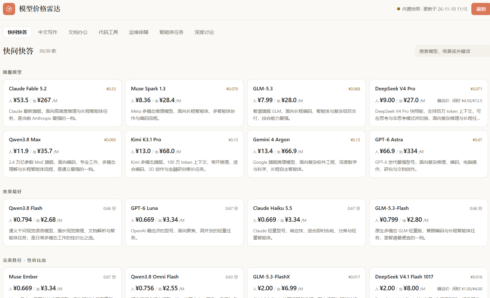

# 模型价格雷达 / Model price radar

DSH 插件：左侧栏图标打开价格面板，按你的工作场景给出 **各家旗舰 + 12 款推荐**，每款都能展开成一整页的中文说明书——
价格（人民币）、能力、参数、适用场景、使用案例、怎么用更好、优缺点。



## 收录范围

- **国内 4 家**：DeepSeek、通义千问、Kimi、智谱 GLM
- **国外 4 家**：ChatGPT（OpenAI）、Claude（Anthropic）、Gemini（Google）、Meta
- 每家厂商**按档位只收最新的那一代**，旧一代同档不显示；新版本发布后刷新即替换。
  图片、语音、Embedding、Realtime 这类非文本计价模型不纳入。

## 面板怎么用

七个场景标签：快问快答、中文写作、文档办公、代码工具、运维排障、智能体任务、深度讨论。
每个场景分成 **4 组**：第一组是各家旗舰，其余三组各 4 款、组间不重复：

| 组 | 选法 | 适合 |
|---|---|---|
| 旗舰模型 | 每家厂商最新最强的顶级型号各一款 | 想看「各家的天花板在哪」 |
| 效果最好 | 排除旗舰后，按能力评分从高到低 | 这活不能出错 |
| 完美胜任 · 性价比高 | A/B 评级里「每元能力」最多 | 长期、大量地跑 |
| 基本满足 · 价格最低 | 评级 C 以上、按价格从低到高 | 能出结果就行 |

同组卡片固定排成一行、四列；旗舰组有几家就显示几张。

每张卡只保留三样东西：模型名、人民币单价（输入/输出，每百万 token）、本场景典型请求的估算花费，
下面一句中文简介收尾；有峰谷价的模型在价格右侧补一行闲时价。卡片不显示厂商名、排名和 A/B/C 评级图标。

点卡片进入**整页详情**（面板内切换，不弹窗），包含：

- 中文简介、一句话定位、档位、上下文、发布日
- **价格对照**：官方 API 与 OpenRouter 并排，只列渠道、输入/输出/缓存单价；未上架则注明；差价过大时给一句提醒
- 峰时/闲时价格、促销到期提醒
- 能力特点、七个场景的评级条
- **4 个使用案例**（按该模型最擅长的场景轮换）
- **如何用得更好**：缓存前缀、推理强度、工具调用、图片输入、闲时批处理等
- 优点 / 注意事项、全部资料来源链接

## 价格口径

- 面板只显示 **人民币**；官方直接以人民币报价的厂商（如 DeepSeek）优先使用官方原价，不经汇率换算，其余按 `open.er-api.com` 的实时汇率折算，失败时用内置参考汇率。
- 有峰谷定价的模型（目前是 DeepSeek 官方 API）以**高峰时段标价**为准（DeepSeek V4.1 Flash：输入 ¥2 / 输出 ¥8 每百万 token；V4 Pro：¥9 / ¥27），闲时为高峰的一半。前者用于排序与花费估算，避免低估；详情里同时列出两档与高峰时段。
- 促销价按当前生效价计算，并在详情里写清到期日与到期后的价格。
- 分段计价按「该请求规模落在哪一档」近似。
- 典型任务花费 = 场景输入 token × 输入单价 + 场景输出 token × 输出单价。

## 场景评级怎么来的

`data/capability-ratings.json` 是**联网调研后的人工评级表**：每个模型给出 7 个场景的 A/B/C/D、一句话定位、
关键事实、注意事项、来源链接和证据强度。评分 = 调研评级（主）+ 任务花费相对中位数（辅），
所以既不会把贵旗舰无脑排第一，也不会让便宜但跑不动的模型上榜。

没有调研条目的模型（新发布、或调研未覆盖）回退到「能力标记 + 榜单名次 + 价格」的推断，并在详情里明确标注。

## 模型介绍中文化

面板与详情只显示中文简介，英文原名（Claude、Gemini、GPT 等）保留不译。
现有 30 款模型的简介人工写在 `data/descriptions-zh.json`，按模型 id 索引；新发布的模型若没有人工简介，
Host 会调用当前 harness 的默认模型翻译英文介绍并缓存（同一段英文只翻一次），界面上不会回退显示英文。
也可以用 `POST /price-radar/translate` 手动补齐。

## 数据来源

| 数据 | 来源 |
|---|---|
| 官方价格、上下文、能力、发布日期 | `https://models.dev/api.json` |
| OpenRouter 参照价（只比价，不出现在列表里） | `https://openrouter.ai/api/v1/models` |
| 榜单名次 | `oolong-tea-2026/arena-ai-leaderboards`（LMArena 日更快照，自动回溯最近有效日） |
| 汇率 | `https://open.er-api.com/v6/latest/USD` |
| 峰谷价、促销截止日 | `data/price-notes.json`（人工核对，附官方来源） |
| 模型点评与场景评级 | `data/capability-ratings.json`（人工调研，附来源） |

**不做的事**：不猜价格、不补零、不造榜单名次、不做模糊型号匹配。榜单没有数据时显示「暂无榜单数据」。

## 配色

面板自带两套主题，跟随宿主在浅色/深色间切换。浅色采用 Claude 现行的暖白界面：
`#FAF9F5` 画布 / `#FFFFFF` 卡面 / `#E6E2D7` 描边 / `#1F1E1D` 正文 / `#D97757` 陶土橙强调；
深色对应 `#1F1E1D` / `#262625` / `#3C3A36` / `#F2F0EA` / `#E08363`。
列表页刻意压到「名称 + 价格 + 一句简介」，详情页才展开参数、评级、案例与优缺点。

## 维护与自检

```bash
node scripts/build-baseline.mjs   # 重新生成内置基线（含比价与价格备注匹配检查）
node scripts/smoke-host.mjs       # Host 接口、刷新、翻译路径自检
node scripts/smoke-client.mjs     # 渲染、四组推荐、整页详情自检
```

安装：

1. 下载 [Release](https://github.com/davzlcm/model-price-radar/releases) 里的 `model-price-radar-1.4.6.zip` 并解压，
   或者 `git clone https://github.com/davzlcm/model-price-radar.git`；
2. 在 DSH 里执行 `plugin_manager install_bundle`，target 指向解压后的**绝对路径**；
3. 重装前先 bump `package.json` 的 version，否则会提示 already-installed。

## 文件

| 文件 | 作用 |
|---|---|
| `index.js` | Host 半：`/price-radar` JSON API、缓存、刷新、翻译、比价 |
| `client.js` | 面板、四组推荐、整页详情、侧栏图标 |
| `lib/sources.js` | 数据源抓取、档位收口（`curateBySlot`）、OpenRouter 比价、价格备注 |
| `lib/translate.js` | 介绍中文化（按内容哈希缓存） |
| `data/baseline.json` | 内置基线快照（离线可用） |
| `data/capability-ratings.json` | 调研评级表（场景 A–D、定位、事实、短板、来源） |
| `data/price-notes.json` | 峰谷价与促销备注 |
| `data/descriptions-zh.json` | 人工中文简介（按模型 id） |
| `data/flagships.json` | 每家厂商的旗舰型号名单 |
| `scripts/build-baseline.mjs` | 重新生成基线 |
| `scripts/smoke-*.mjs` | 自检脚本 |
| `assets/screenshot-light.png` | README 里的面板预览图 |

## 许可

MIT
